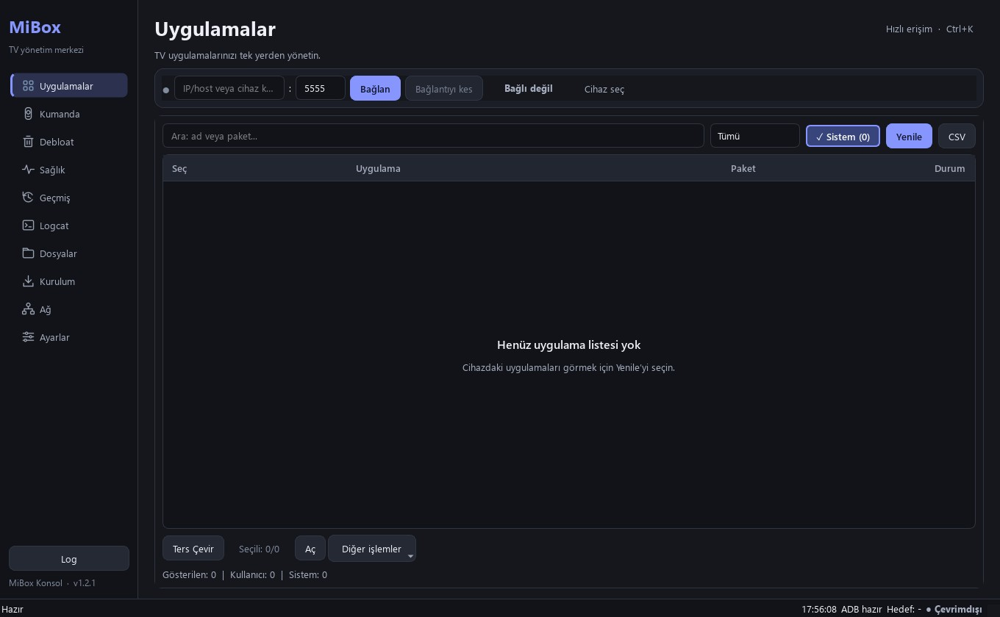
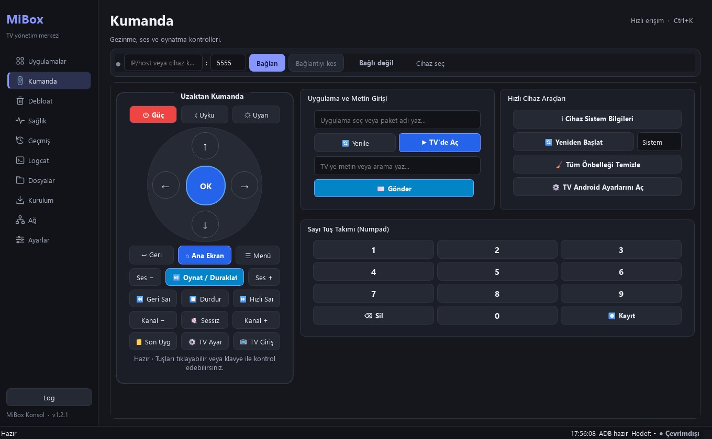
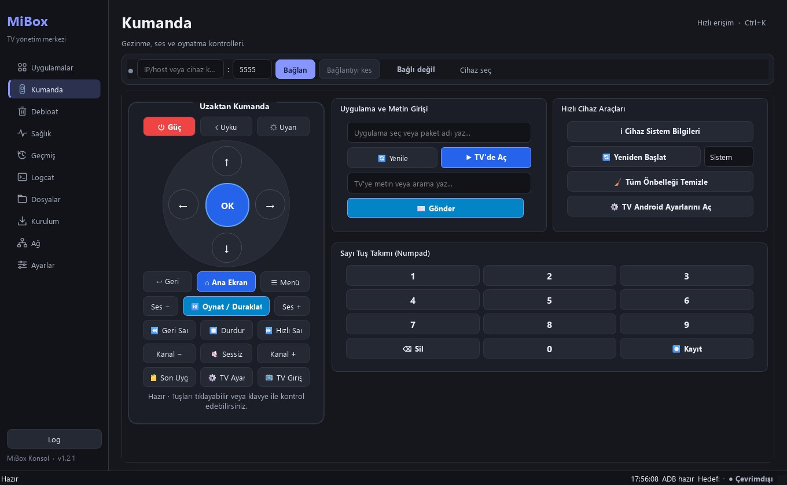
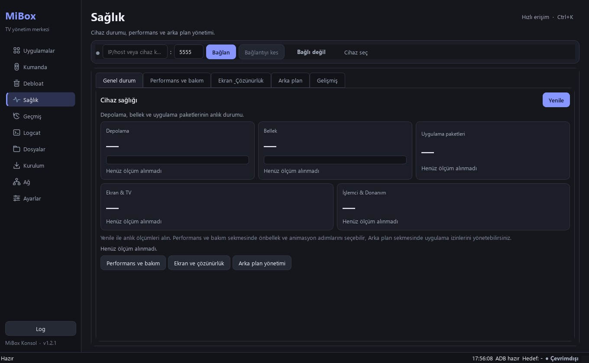
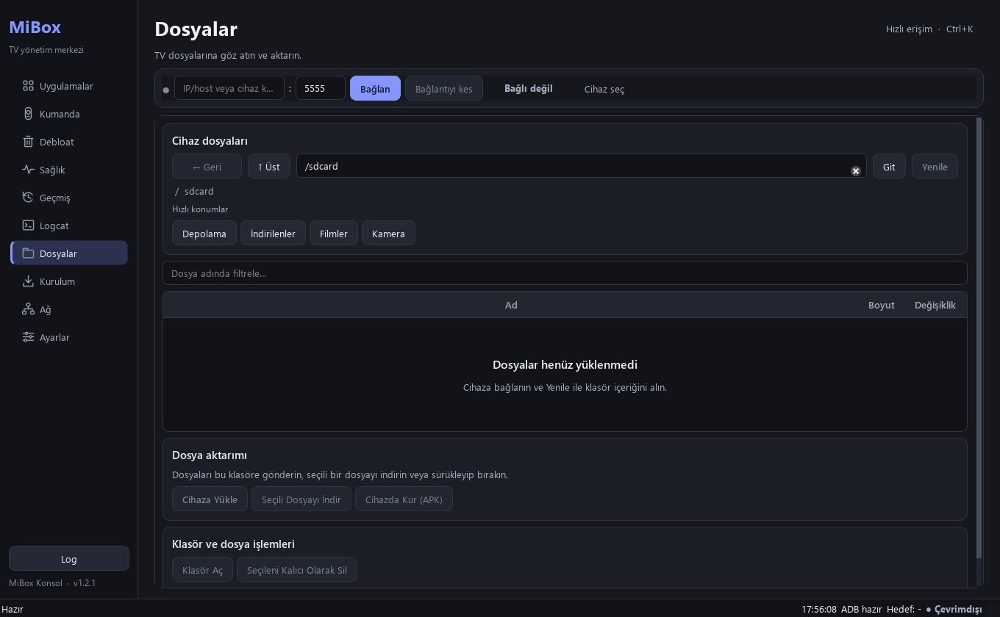
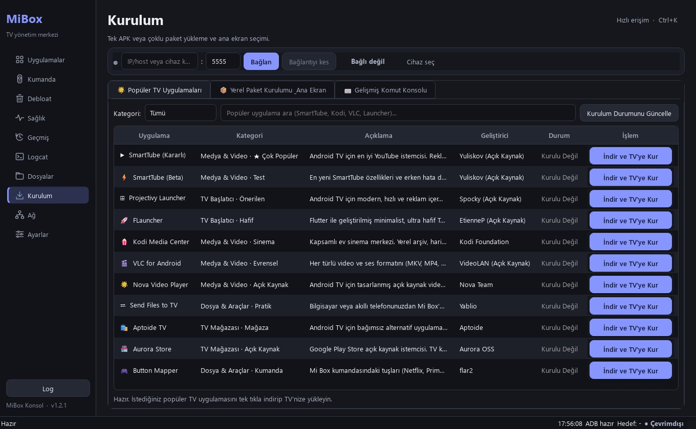

# MiBox Konsol

<p align="center">
  <a href="LICENSE"></a>
  <a href="https://python.org"></a>
  <a href="https://wiki.qt.io"></a>
  <a href="https://www.microsoft.com"></a>
</p>

Xiaomi Mi Box, Mi TV Stick ve tüm Android TV cihazlarını yerel ağ üzerinden (ADB) yönetmek, optimize etmek ve gereksiz sistem uygulamalarından (bloatware) arındırmak için geliştirilmiş modern, açık kaynaklı Windows masaüstü yönetim merkezi.

**Sürüm:** `v1.2.1`

---

## 📸 Ekran Görüntüleri

<table>
  <tr>
    <td width="50%" align="center">
      <br>
      <strong>Uygulamalar & Paket Yönetimi</strong>
    </td>
    <td width="50%" align="center">
      <br>
      <strong>Ön Planda Kumanda & Canlı Ekran</strong>
    </td>
  </tr>
  <tr>
    <td width="50%" align="center">
      <br>
      <strong>Gelişmiş Debloat & Hazır Profiller</strong>
    </td>
    <td width="50%" align="center">
      <br>
      <strong>Cihaz Sağlığı & Donanım Telemetrisi</strong>
    </td>
  </tr>
  <tr>
    <td width="50%" align="center">
      <br>
      <strong>Dosyalar & USB Yönetimi</strong>
    </td>
    <td width="50%" align="center">
      <br>
      <strong>TV Uygulama Marketi & Sideload</strong>
    </td>
  </tr>
</table>

---

## 🚀 Öne Çıkan Özellikler

### 1. 🛍️ Popüler TV Uygulama Kataloğu & Sideload (App Store)
- Android TV için optimize açık kaynaklı ve popüler uygulamaları tek tıkla resmi kaynaklarından indirip TV'ye yükleme:
  - **Medya & Video:** SmartTube (Kararlı & Beta), Kodi, VLC for Android, Nova Video Player
  - **Arayüz (Launcher):** Projectivy Launcher, FLauncher
  - **Araçlar & Transfer:** Send Files to TV, Button Mapper, Aptoide TV, Aurora Store
- TV'de anlık kurulu olma durumunu denetleme (`✓ TV'de Kurulu`), doğrudan başlatma (`▶ TV'de Aç`) ve yeniden kurma.
- İndirme hızı (KB/s - MB/s) ve bayt ilerleme göstergeli arka plan iş parçacığı.
- Katalog uygulamaları MiBox tarafından yayımlanmaz; kurulum öncesi kaynak ve paket adı gösterilir, otomatik izin verme varsayılan olarak kapalıdır.

### 2. 🎛️ Ön Planda TV Uzaktan Kumandası & Canlı Ekran Etkileşimi
- **Ferah ve Ön Planda Kumanda:** 400px genişliğinde, 170px dairesel D-Pad takımına ve 34px yükseklikte rahat butonlara sahip ergonomik fiziksel kumanda tasarımı.
- **Canlı Önizleme:** TV ekranını PC üzerinden gerçek zamanlı izleme, fareyle dokunma (tap) ve sürükleme (swipe).
- **Klavye Yönlendirmesi:** PC klavye yön tuşlarını, Enter (OK), Esc/Backspace ve sayıları TV'ye anında iletme.
- **Hızlı Metin Gönderimi:** TV arama kutularına PC klavyesinden doğrudan Türkçe metin yapıştırma ve tek tıkla uygulama başlatma.

### 3. 🖥️ Ekran Çözünürlüğü, DPI & Overscan Yöneticisi
- **Çözünürlük Değiştirme:** 1080p Full HD, 720p HD (menü ve donanım hızlandırma için ideal), 4K UHD arasında geçiş.
- **Arayüz Ölçeği (DPI):** 240 DPI (Kompakt), 280 DPI, 320 DPI (Standart), 360 DPI (Büyük yazılar).
- **Ekran Kenar Taşması (Overscan):** Kenarları kesilen TV'ler için 15px, 30px, 45px içeri çekme veya sıfırlama.
- **Güvenlik Sayacı:** Onaylanmayan değişiklikler 15 saniye içinde otomatik olarak fabrika değerlerine geri döner.

### 4. 📶 Canlı TV Wi-Fi & Ağ Sağlığı Teşhisi
- TV kutusunun anlık sinyal gücü (RSSI dBm & %), link bağlantı hızı (Mbps) ve frekans bandı (5 GHz / 2.4 GHz).
- TV kutusundan modeme gerçek zamanlı ping gecikmesi ve paket kaybı testi.
- 4K yayın uyumluluğu ve modem mesafesi analizi sunan akıllı Türkçe tavsiye motoru.

### 5. 🧹 Gelişmiş Debloat & Sistem Temizliği
- Android 9-14, Google TV ve Xiaomi HyperOS için güvenli/opsiyonel/riskli paket sınıflandırması.
- **Hazır Profiller:** `xiaomi_ultra`, `low_ram`, `google_clean` ile tek tıkla temizlik.
- Yapılan işlemler öncesinde otomatik anlık yedek (`snapshot`) alarak istenildiği an tek tıkla geri yükleme (rollback).

### 6. ⚡ 1-Tıkla Süper Hızlandırma & Donanım Telemetrisi
- Arka plan önbelleklerini temizler, gereksiz süreçleri sonlandırır, animasyonları 0.5× ölçeğine alarak cihazı ferahlatır.
- CPU/SoC yonga seti, çekirdek sayısı, termal işlemci sıcaklığı, RAM ve depolama doluluk oranları.

### 7. 📁 Dosya Yöneticisi & Özel Güvenli DNS
- TV dahili depolaması ve bağlı USB bellekler arasında dosya transferi, TV'den PC'ye çekme (pull) ve PC'den TV'ye yükleme (push).
- Reklam ve izleyicileri engellemek için AdGuard DNS, Cloudflare DNS ve Google DNS arasında tek tıkla geçiş.

### 8. 🛡️ Güvenlik Kapısı (Command Gate) & Kesintisiz Kapanış
- Cihazı kilitleyebilecek (`mkfs`, `rm -rf /`, `wipe`) tehlikeli komutları engelleyen yetkilendirme katmanı.
- Kapanışta arka plandaki ADB soket süreçlerini bekletmeyen 600ms korumalı akıllı çıkış mekanizması.

---

## 💻 Sistem Gereksinimleri

- **İşletim Sistemi:** Windows 10, Windows 11 (veya Windows 7 / 8 / 8.1)
- **Mimari:** Hem **64-bit (x64)** hem de **32-bit (x86)** Windows sistemleri tam desteklenir.
- **Python:** Python 3.10 veya üzeri (32-bit veya 64-bit)
- **ADB:** Android platform araçlarından ADB (`adb.exe`). Uygulama `PATH` üzerinde veya kendi klasöründe ADB'yi otomatik tespit eder.

---

## 🚀 Hızlı Başlangıç

### 1. Tek Tıkla Çalıştırma (Önerilen)
Depoyu indirdikten sonra doğrudan **`MiBox_Konsol.bat`** dosyasına çift tıklayın. Sistem mimarinizi (x64 veya x86) otomatik tespit eder, gerekli Qt kütüphanesini hazırlar ve uygulamayı açar.

### 2. Kaynaktan Manuel Çalıştırma

**64-bit Windows Sistemler:**
```powershell
python -m venv .venv
.venv\Scripts\Activate.ps1
pip install -r requirements.txt
python mibox.py
```

**32-bit (x86) Windows Sistemler:**
```powershell
python -m venv .venv
.venv\Scripts\Activate.ps1
pip install -r requirements-x86.txt
python mibox.py
```

---

## 📦 Çalıştırılabilir (.exe) Oluşturma

PyInstaller ile tek dosya veya taşınabilir klasör paketi oluşturabilirsiniz:

- **Otomatik Mimarili Derleyici (x64 / x86):**
  ```bat
  build_exe.bat
  ```
- **Özel 32-bit (x86) Derleme:**
  ```bat
  build_exe_x86.bat
  ```
- **Klasör Modu (ONEDIR):**
  ```bat
  build_exe_onedir.bat
  ```

---

## 📁 Proje Dizin Yapısı

```
mibox/
├── .github/                  # GitHub Actions CI ve şablonlar
│   ├── workflows/            # CI ve Release otomasyonları
│   └── ISSUE_TEMPLATE/       # Hata ve istek bildirim şablonları
├── mibox_app/                # Çekirdek Python paketi
│   ├── adb_engine.py         # ADB komut motoru ve soket yönetimi
│   ├── catalog.py            # TV uygulama mağazası kataloğu
│   ├── config.py             # Yapılandırma ve kalıcı ayarlar
│   ├── diagnostics.py        # Çevre ve mimari tanı motoru
│   ├── gate.py               # Güvenlik izin kapısı
│   ├── qt_compat.py          # 64-bit (PySide6) / 32-bit (PyQt5) şimi
│   ├── workers.py            # QThread tabanlı arka plan iş parçacıkları
│   └── ui/                   # Qt arayüz bileşenleri ve sekmeler
│       ├── apps_tab.py       # Uygulama yöneticisi
│       ├── debloat_tab.py    # Debloat ve profil sihirbazı
│       ├── display_panel.py  # Ekran çözünürlüğü ve DPI yöneticisi
│       ├── health_tab.py     # Sağlık ve donanım telemetrisi
│       ├── install_tab.py    # TV App Store ve APK yükleyici
│       ├── logcat_tab.py     # Canlı Logcat konsolu
│       ├── main_window.py    # Ana pencere ve navigasyon
│       ├── network_tab.py    # Canlı Wi-Fi teşhisi ve ping
│       ├── remote_tab.py     # Ergonomik TV kumandası ve canlı ekran
│       ├── settings_tab.py   # Ayarlar ve tanı paneli
│       └── theme.py          # Modern koyu/açık tema motoru
├── build_exe.bat             # Otomatik EXE derleyici
├── build_exe_x86.bat         # 32-bit EXE derleyici
├── MiBox_Konsol.bat          # Hızlı başlatıcı
├── mibox.py                  # Giriş noktası
├── pyproject.toml            # Modern paketleme metaverisi
├── requirements.txt          # 64-bit bağımlılıklar
└── requirements-x86.txt      # 32-bit bağımlılıklar
```

---

## 🌐 English Overview

**MiBox Konsol** is an open-source, full-featured desktop management console and debloating toolkit for **Xiaomi Mi Box, Mi TV Stick**, and all **Android TV** devices via ADB over Wi-Fi or USB.

- **TV App Store:** One-click download & installation of top open-source TV apps (SmartTube, Kodi, VLC, Projectivy Launcher, etc.).
- **Hero TV Remote:** Ergonomic 400px physical remote control with a 170px circular D-pad, live screen mirroring (tap & swipe), and PC keyboard pass-through.
- **Resolution & DPI Manager:** Seamless switching between 4K, 1080p, and 720p with overscan correction and a 15-second safety rollback timer.
- **Live Wi-Fi Diagnostics:** Real-time signal strength (RSSI), link speed (Mbps), frequency band (5GHz/2.4GHz), and gateway ping analysis.
- **Advanced Debloater:** Curated safe/optional/critical lists with one-click presets and automatic snapshot restore.
- **Dual Qt Engine Support:** Full native support for **64-bit Windows (PySide6 / Qt 6)** and **32-bit x86 Windows (PyQt5 / Qt 5)** via `qt_compat`.

---

## 🤝 Katkıda Bulunma

Açık kaynak katkılarınızı memnuniyetle kabul ediyoruz! Lütfen katkı göndermeden önce [CONTRIBUTING.md](CONTRIBUTING.md) rehberini inceleyin.

## 📄 Lisans

Bu proje [MIT Lisansı](LICENSE) altında açık kaynak olarak dağıtılmaktadır.
